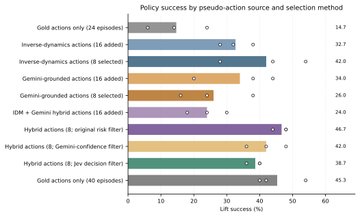

# Jev Lift pilot

This repository tests whether missing robot actions can be reconstructed well
enough to train a downstream behavior-cloning policy. It also contains a
smaller follow-up that evaluates **TypeSafe Jev 1.13 through OpenRouter** as an
episode-quality selector.

The experiment uses robomimic Lift demonstrations. The raw files contain
actions, but the pipeline deliberately hides the actions of 16 training
episodes to simulate actionless video. This is a controlled missing-label
study on one simulated task, not evidence that arbitrary internet video can be
converted into robot controls.

## Systems evaluated

The names describe the architecture and keep **Jev** reserved for the hosted
TypeSafe model:

1. **Inverse dynamics (IDM):** a trained model predicts 7D OSC_POSE actions
   from frozen DINOv2 transition features.
2. **Gemini grounding:** Gemini 3.6 Flash describes rendered frame sequences;
   a trained grounding network maps those descriptions and visual features to
   robot actions. A hybrid also combines these inputs with IDM predictions.
3. **Jev decision filter:** `typesafe/jev-1.13`, called through OpenRouter,
   reads cached Gemini descriptions and scores ambiguity or inconsistency. Jev
   selects episodes whose already-saved hybrid pseudo-actions train a policy.
   Jev does not view images or generate continuous robot actions in this study.

## Main results

Every pseudo-action policy below uses the same 24 gold-action episodes. “16
added” uses all masked training episodes; “8 selected” keeps half of them.
Each success rate averages three policy-training seeds evaluated on the same
50 simulator starts per seed.

| Policy training data | Lift success |
|---|---:|
| 24 gold episodes only | 14.7% |
| IDM pseudo-actions, 16 added | 32.7% |
| IDM pseudo-actions, 8 selected | 42.0% |
| Gemini-grounded pseudo-actions, 16 added | 34.0% |
| Gemini-grounded pseudo-actions, 8 selected | 26.0% |
| IDM + Gemini hybrid pseudo-actions, 16 added | 24.0% |
| Hybrid actions, 8 selected by original risk score | 46.7% |
| Hybrid actions, 8 selected by Gemini confidence | 42.0% |
| Hybrid actions, 8 selected by Jev | 38.7% |
| 40 gold episodes | 45.3% |



Pseudo-labeling improved the point estimate over training on 24 gold episodes
alone. Gemini-grounded actions did not establish an advantage over the IDM
control: the prespecified difference was +1.3 percentage points with a wide
interval. The filtered hybrid result is also uncertain across only three
training seeds.

The Jev follow-up was negative for the decision task tested here. Its selected
policy reached 38.7%, compared with 42.0% for the matched Gemini-confidence
selector and 46.7% for the earlier risk selector. Jev’s calibrated held-out
error ranking was near chance (AUC 0.491). This tests one prompt and one cached
description distribution; it does not measure general Jev capability.

## Experimental scope

- Dataset: 200 robomimic Lift episodes, 9,666 transitions, 20 Hz.
- Frozen split: 120 train, 20 development, 20 calibration, 40 locked test.
- Pilot pool: 24 action-visible and 16 action-masked training episodes.
- Controller: 7D OSC_POSE action in native `[-1, 1]` units.
- Closed loop: three trained policies per arm, 50 paired starts, 200-step
  horizon.
- The locked 40-episode test partition was not evaluated.
- The study has one task, one pilot split, and limited training-seed
  replication. Intervals in the paper are descriptive, not equivalence tests.

## Repository layout

```text
config/                 frozen experiment configuration
jev_research/           audits, inverse dynamics, grounding, calibration,
                        policy training, and evaluation
research/jev/           hosted Jev client and E3b runner
results/runs/           lightweight JSON used by the paper and figures
figs/                   data-derived figure script and generated figures
tests/                  integrity and hosted-client tests
paper.tex, paper.pdf    corrected scientific report
```

Large datasets, checkpoints, RGB caches, raw Gemini responses, raw Jev
responses, and API credentials are intentionally excluded.

## Reproduce the figures and paper

Python 3.11 was used for the completed run. Install the scientific and
robomimic dependencies in an isolated environment:

```bash
python -m venv .venv
source .venv/bin/activate
pip install -r requirements.txt
python figs/make_policy_fig.py
pdflatex -interaction=nonstopmode -halt-on-error paper.tex
pdflatex -interaction=nonstopmode -halt-on-error paper.tex
```

The figure script defaults to the committed `results/runs` records and makes
no model or API calls.

To rerun the robot experiments, place robomimic Lift PH raw and low-dimensional
HDF5 files under `~/.local/share/jev_test/data/`, then select a phase in
`config/variant.json` and run:

```bash
python -m jev_research.run
```

The E0 audit must pass for the exact code, configuration, and datasets before
later phases run.

## Hosted Jev credentials

Only the E3b runner makes Jev calls. It expects a local, ignored `.env` file:

```text
jev_openrouter=YOUR_OPENROUTER_KEY
```

The client pins `typesafe/jev-1.13`, validates the resolved TypeSafe provider,
fails closed on malformed responses or fallback, caches requests locally, and
enforces a run budget. Never commit `.env` or response caches.

## Paper

The paper reports the complete architecture, action-reconstruction diagnostics,
selection diagnostics, policy comparisons, uncertainty analysis, costs, and
limitations. Start with [`paper.pdf`](paper.pdf); the editable source is
[`paper.tex`](paper.tex).
